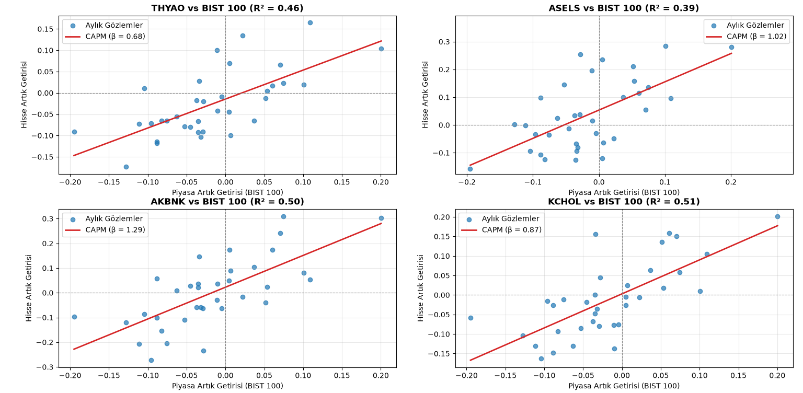

# bist100-capm-beta-analysis
CAPM regression and beta analysis of selected BIST 100 equities in Python using OLS.

# BIST 100 CAPM Beta Analysis

A small CAPM regression project in Python looking at how a few BIST 100 stocks (`THYAO`, `ASELS`, `AKBNK`, `KCHOL`) move relative to the `XU100.IS` index[cite: 3]. I built it to connect basic financial theory with real market data and see how beta and regression fit behave in practice[cite: 3].

## What I Did
* Pulled 3 years of price data via `yfinance` and resampled to month-end returns[cite: 3].
* Computed excess returns using a simplified constant risk-free rate assumption and ran OLS regressions with `statsmodels`.
* Plotted the regression lines alongside monthly observations and checked **Beta ($\beta$)**, **Alpha ($\alpha$)**, and **$R^2$**[cite: 3].

## Chart


## Takeaways & Caveats
* **Beta ($\beta$):** Values above 1 point to stronger sensitivity to market swings; values below 1 look comparatively calmer[cite: 3].
* **$R^2$:** Shows how much of the return variation lines up with the index versus stock- or sector-specific noise[cite: 3].
* **Assumptions:** Keeping the risk-free rate fixed and using monthly data makes the setup cleaner, though real markets are messier and rates shift over time.

## Setup & Run
```bash
pip install -r requirements.txt
python capm_bist100.py
```
